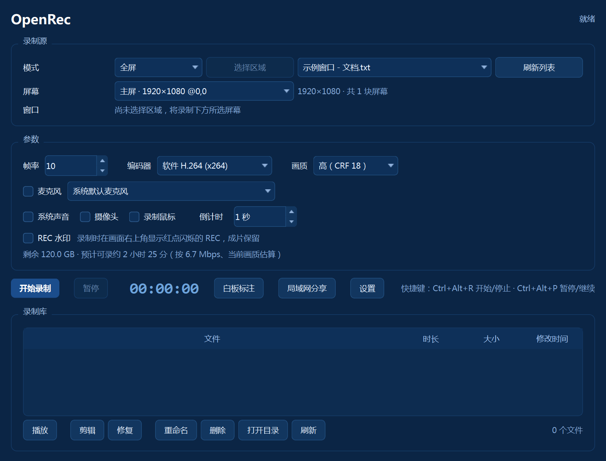

# OpenRec · 本地录屏

<p></p>

参照 EV 录屏的**本地功能**做的干净室复刻：全屏/区域/窗口/仅音频录制、麦克风与系统声混音、摄像头叠加、白板标注、剪辑、录制库、损坏视频修复、局域网扫码观看。

**不联网、不登录、无会员体系、无云端上传。** 唯一会用到网络的是你手动开启的「局域网分享」，且只在本机开启 HTTP 服务，不上传任何数据。



## 功能对照（本地能力）

| 能力 | OpenRec | 说明 |
|---|---|---|
| 全屏录制 | ✅ | 支持指定单块屏幕，或「所有屏幕」拼接画面 |
| 自定义区域 | ✅ | 拖拽选区；选定单屏时选区自动限定在该屏内，选「所有屏幕」可跨屏 |
| 指定窗口 | ✅ | 按窗口标题跟踪位置；窗口缩放会安全收尾（避免画面错位） |
| 仅音频 | ✅ | 输出 `.m4a`（AAC 192k） |
| 麦克风 + 系统声 | ✅ | WASAPI 采集后实时混音 |
| 摄像头叠加 | ✅ | 右下角画中画，尺寸可调 |
| 鼠标指针 | ✅ | 绘制指针位置（简化箭头样式） |
| 文字水印 | ✅ | 设置中填写文字，右下角叠加 |
| 倒计时 | ✅ | 0–10 秒，居中提示 |
| 暂停 / 继续 | ✅ | 暂停期间不写入帧与音频，时间轴自动压缩 |
| 全局快捷键 | ✅ | 默认 `Ctrl+Alt+R` 开始/停止，`Ctrl+Alt+P` 暂停；设置中点按输入框即可按键录入自定义组合，主界面显示当前快捷键 |
| 托盘常驻 | ✅ | 关闭窗口时弹窗选择：退出程序 / 最小化到托盘 / 取消；最小化后录制不中断 |
| 录制提示水印 | ✅ | 录制前勾选，录制时在采集区域右上角实时显示闪烁 REC 并进入成片；不勾选则干净视频 |
| 单实例运行 | ✅ | 重复双击不会双开，会激活已运行的窗口 |
| 磁盘空间保护 | ✅ | 开始前低于 2 GB 拒绝录制；界面按画质估算可录时长；录制中到 2 GB 自动停止并保存 |
| 白板标注 | ✅ | 全屏透明画板，画什么录什么 |
| 硬件编码 | ✅ | NVENC / QSV / AMF 自动检测，失败自动只显示可用项 |
| 高帧率游戏采集 | ✅ | 单屏全屏或区域 + NVENC 时自动切换到桌面复制（DDA）+ NVENC 直连，帧率档位 5–120 fps；实测 2880×1800 60 fps 约 59 帧、120 fps 约 90–97 帧 |
| 录制库 | ✅ | 播放、重命名、删除、打开目录 |
| 剪辑 | ✅ | 起止时间精确重编码导出 |
| 损坏修复 | ✅ | FFmpeg 三级修复策略 |
| 局域网分享 | ✅ | 扫码观看/下载，支持 Range 边下边播，8 位访问口令，连续输错自动锁定 |

### 明确未包含

云端上传、账号登录、VIP/付费、直播推流（RTMP）、虚拟摄像头、视频加密、课程加密、多轨专业剪辑、AI 字幕。这些要么依赖联网服务，要么属于另一类产品。

## 运行

本仓库只包含源码与构建脚本，不包含 `bin\`、`build\`、`dist\`、安装包与录像等生成物。

**安装版（推荐）**：双击 `OpenRec_Setup_1.6.8.exe`，按向导完成安装，桌面与开始菜单会出现快捷方式。安装到当前用户目录，无需管理员权限；卸载通过「设置 → 应用」或开始菜单中的卸载项。

安装版的配置保存在 `%LOCALAPPDATA%\OpenRec\data`，录像默认保存到「视频\OpenRec」，可在程序内修改。升级安装会保留设置。

**免安装版**：双击 `dist\OpenRec\OpenRec.exe`。程序文件解压即用，但配置仍保存在 `%LOCALAPPDATA%\OpenRec\data`，录像默认保存到「视频\OpenRec」，与安装版完全一致；如需彻底移除，删除程序目录与上述配置目录即可。

源码运行：要求 Windows 10/11、Python 3.12+（`requirements.lock` 按 3.13 验证；仅用 `requirements.txt` 时 3.10/3.11 也可安装）。

```bat
pip install -r requirements.txt
run.bat
```

运行日志写入数据目录下的 `logs\openrec.log`（最大 1 MB 滚动，仅记本地事件）。纯函数单测：`python -m unittest discover -s tests`。

无界面自检（不弹窗，录 3 秒并写 `selftest.txt`）：

```bat
dist\OpenRec\OpenRec.exe --selftest
```

仓库不含 FFmpeg 二进制（单文件约 105 MB，超过 GitHub 的 100 MB 限制）。请自行下载 FFmpeg 9.0.2 essentials（含 libx264/aac/NVENC/QSV/AMF），把 `ffmpeg.exe`、`ffprobe.exe` 放入 `bin\` 目录（该目录已在 `.gitignore` 中忽略）。

打包为独立 exe：

```bat
pip install pyinstaller
pyinstaller --noconfirm OpenRec.spec
```

产物在 `dist\OpenRec\`，`bin\` 会随包复制。

生成安装包（需 Inno Setup 6）：

```bat
"%LOCALAPPDATA%\Programs\Inno Setup 6\ISCC.exe" installer\OpenRec.iss
```

版本号唯一来源为 `openrec/config.py` 的 `APP_VERSION`（exe 文件属性自动同步）；`installer/OpenRec.iss` 顶部的 `MyAppVersion` 需同步修改。

## 目录结构

```
OpenRec/
  main.py               启动入口与深色主题
  openrec/
    config.py           本地 JSON 配置（data/settings.json）
    recorder.py         采集、混音、FFmpeg 管道、剪辑/修复
    overlays.py         区域选择、倒计时、白板
    hotkeys.py          全局快捷键线程
    share.py            局域网 HTTP 分享
    ui.py               主界面
    capture.py          mss / DXcam 采集源
  bin/                  ffmpeg.exe / ffprobe.exe
  docs/                 图标与界面示意
  installer/            安装包脚本（OpenRec.iss）
  recordings/           源码运行时的默认输出目录
```

## 实现要点

- **采集**：三条通路按优先级自动选择——`ddagrab`（硬件桌面复制直连 NVENC，几乎不占 CPU）> `dxcam`（DXGI 桌面复制，抓一帧 1–3 ms）> `mss`（BitBlt，任何环境可用但 4K 下单帧约 60 ms）。窗口模式用 DWM 扩展边框矩形跟踪位置；旋转屏与「所有屏幕」走 mss。
- **多屏选择**：全屏模式下「屏幕」下拉列出所有物理显示器和「所有屏幕（拼接）」；选择结果按 mss 的 `unique_id` 记忆，显示器插拔时列表自动刷新，找不到原屏幕则回退主屏。
- **单实例**：启动时先尝试连接命名管道 `OpenRec.SingleInstance.v1`；已有实例则发送激活消息并退出，避免双开抢占全局快捷键。
- **REC 角标**：勾选「REC 水印」后，录制期间在采集区域右上角显示置顶、鼠标穿透的角标（红点每 0.5 秒闪烁），并随屏幕采集实时进入成片；取消勾选则完全不显示。最小化到托盘时角标仍在。
- **后台录制**：最小化到托盘只隐藏窗口，采集与编码线程不受影响，计时与快捷键照常工作。
- **全局快捷键**：独立线程用 `RegisterHotKey` 注册，任何窗口焦点下都能开始/停止录制；设置中点按输入框直接按下组合键即可录入，自动校验必须含 Ctrl/Alt/Shift/Win 且两键不重复，暂停键留空可禁用。主界面实时显示当前组合。
- **长时间录制保护**：录制期间调用 `SetThreadExecutionState` 阻止系统休眠与自动关屏；BitBlt 抓帧短暂失败会重试并重建采集对象，持续失败（如显示器休眠、断开、锁屏）则自动收尾，把中断前已录内容正常封装保存并提示，不再直接丢弃。
- **磁盘空间保护**：开始录制前检查保存目录所在磁盘，低于 2 GB 直接提示无法开始；参数区按分辨率、帧率、画质与音频开关估算码率，实时显示「剩余空间 / 预计可录时长」。录制中每秒检查一次，剩余 2 GB 时自动停止并保存；若空间不足以再合成 MP4，则直接按原格式保存 MKV（有音频时另存同名 WAV），确保录像不丢。
- **选区约束**：选中单块屏幕时，区域选择遮罩只覆盖该屏，拖拽出的区域必定落在该屏内；选「所有屏幕」时可跨屏框选。松开鼠标即确认选区，Esc 取消。
- **视频编码**：原始 BGRA 帧通过 stdin 管道送入 FFmpeg，封装为 Matroska 临时文件，结束后与音频合成 MP4（`+faststart`）。
- **音频**：`soundcard` 以 WASAPI 采集默认麦克风与扬声器回环，48 kHz / 双声道，按块混音后写入 WAV，最终 AAC 192k。
- **暂停**：视频与音频线程同时跳过写入，因此暂停段不会出现在成片里。
- **保存不卡界面**：停止录制后的收尾（重封装整个文件、合成音频）在后台线程执行，界面显示「正在保存…」并保持响应；19 分钟 4K（约 6 GB）重封装约 15–20 秒，期间可正常操作窗口。退出程序时会等待收尾完成，避免录像损坏或丢失。
- **实时时间轴**：以单调时钟为基准，采集慢于设定帧率时补重复帧、快于设定帧率时跳帧；若瓶颈在编码器导致补帧也追不上，收尾时按真实时长拉伸时间戳（`-itsscale` 无损重封装），不会出现“加速”成片。编码器统一关闭 B 帧，既压低延迟，也保证校正后 MP4 头部时长准确。
- **高帧率采集**：单屏全屏或区域、NVENC、未开摄像头/文字水印时，自动改用 FFmpeg `ddagrab`（Windows 桌面复制 API）直接送入 NVENC，支持 5–120 fps 档位，绕开 Python 抓屏与原始帧管道；区域模式通过 `video_size + offset` 精确裁切，实测与 mss 选区逐像素一致；副屏同样支持（`ddagrab` 按 DXGI 输出号自动匹配；`dxcam` 遇到多块同分辨率输出无法唯一确定时自动退回 `mss`，保证录制不串屏）。鼠标由系统绘制进画面，REC 角标与桌面内容一起采集。该模式暂不支持暂停，窗口/所有屏幕模式仍走原采集。
- **资源占用**：`dxcam` 用自有预分配缓冲 + `np.copyto`（防撕裂、内存恒定），写管道用 `memoryview` 免一次整帧拷贝；`libx264` 固定 8 线程（默认按核数开线程时 2K 光帧缓冲就要 1.6 GB）；采集结束后立即 `stop()/release()` 释放显存与句柄。本机 4K 实测：`ddagrab`+NVENC 60 fps 时 CPU 约 7%、GPU 约 46%、进程树内存 +305 MB；`dxcam`+NVENC 30 fps 时 CPU 约 88%、内存 +521 MB。
- **白板**：置顶透明窗口直接画在屏幕上，屏幕采集自然包含，无需额外合成。
- **分享**：`ThreadingHTTPServer` + Range 支持；仅绑定本机局域网地址，根路径与下载均校验 8 位口令（`secrets` 生成），同一来源连续输错 5 次锁定 1 分钟；二维码 URL 直接携带口令，未带口令只能看到输入页，不会泄露文件名。改保存目录后分享立即跟随，无需重启。

## 已知限制

- 窗口被其他窗口遮挡时，只能录到可见部分（不做逐窗口离屏渲染）。
- 窗口模式按启动时的尺寸录制；录制中缩放窗口会立即安全收尾并保存，避免画面错位。
- 「所有屏幕」按虚拟桌面整体抓取，会包含屏幕之间的空隙；4K 多屏拼接分辨率很大，建议降低帧率或改用单屏录制。
- 暂停是「剪切」而非「留空」：暂停时段不会出现在视频里。
- 锁屏、切换用户或显示器物理断电时桌面 DC 不可用，录制会在数秒重试后自动停止并保存已录内容；需要全程连续录制时请保持桌面解锁、显示器连接。
- 预估可录时长按典型画面复杂度估算，实际码率随画面变化；高动态画面可能更早占满磁盘。
- 空间不足自动停止时，若剩余空间不够再合成 MP4，会保留 MKV（音频为同名 WAV）而不是强行封装。
- 无音频录制同样是真正的 MP4；收尾需要重封装一次（约十几秒/6 GB），在后台执行，界面不会卡住。
- 音频按 WAV 分片写入，单段上限 3.8 GB（约 5.5 小时），超过自动切段并在收尾无缝拼接，不限制总时长。
- 高分辨率下编码器若跟不上设定帧率，程序会自动补重复帧保证时长正确，画面可能出现短暂停顿但不会被加速；可降低帧率或改用硬件编码获得更流畅的画面。
- 高帧率采集仅在「单屏全屏/区域 + NVENC + 无摄像头/文字水印」时启用；此时暂停不可用，窗口/所有屏幕模式仍走原采集并支持暂停。部分独占全屏游戏可能无法被桌面复制，建议游戏使用无边框窗口模式。
- 桌面复制在锁屏、显示器休眠或独占全屏切换时会暂时没有新帧：启动阶段会退回 BitBlt；录制中则每 10 次失败重建一次采集对象，持续 8 秒仍无画面才自动收尾保存。
- 帧率档位最高 120 fps，实际受硬件限制。本机实测（2880×1800 主屏 / 3840×2160 副屏）：`ddagrab`+NVENC 4K60 稳定 59.3 fps（CPU 7%）；`dxcam`+NVENC 4K 最高约 54.5 fps（原始帧管道在 4K 需约 4 GB/s 内存拷贝），2K 60 fps 及以下无压力。4K60 建议用 NVENC（会自动走 `ddagrab`）。
- 旋转（竖屏）显示器与「所有屏幕」不走桌面复制，4K 竖屏只能走 BitBlt，帧率会明显低于横屏。
- 区域选择按所在屏幕的 DPI 换算；极端混合缩放场景建议先试录确认范围。
- 局域网分享为明文 HTTP + 口令保护，仅在可信网络使用；不暴露到公网。

## 隐私与合规

- 除手动开启的局域网分享外，程序不向互联网发送任何数据：不登录、不上传录像、不读取账号信息；获取本机局域网地址只做本地路由选择/主机名解析，不发送数据包。
- 本项目为按功能描述独立实现的干净室复刻，未使用 EV 录屏的任何代码、二进制、图标或商标。
- 随包 FFmpeg 为 GPL 构建（gyan.dev essentials），分发时请遵守其许可；如需闭源分发可替换为 LGPL 构建。

## 许可

- 本项目以 **MIT License** 开源。作者：C.C.；版权：Copyright © 2026 C.C.；完整许可见 [`LICENSE`](LICENSE)（安装版与免安装版程序目录均随附）。
- 随包 `LICENSES\GPL-3.0.txt` 为 GNU GPLv3 全文，`LICENSES\FFmpeg-NOTICE.txt` 为 FFmpeg 版权、无担保声明与源码获取说明，用于履行 GPLv3 §4/§6 的分发义务。
- 第三方组件许可（程序内「设置 → 关于」同样可见）：PySide6（LGPL-3.0-only / GPL-2.0-only / GPL-3.0-only 三选一）、FFmpeg（GPL-3.0）、NumPy（BSD-3-Clause AND 0BSD AND MIT AND Zlib AND CC0-1.0）、OpenCV（Apache-2.0）、mss/DXcam（MIT）、SoundCard/qrcode（BSD-3-Clause）、Pillow（MIT-CMU）。
